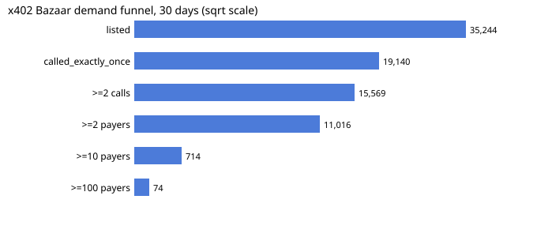
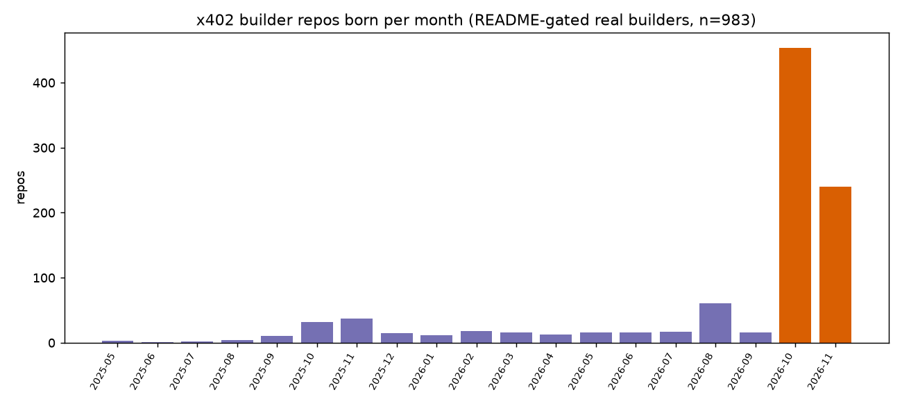

# The x402 Open Book: catalog dollars, GitHub builders, and what the rail actually pays

*Two censuses, one rail.* **CDP Bazaar** (Coinbase's discovery catalog — one of several; see §0 / §2): every listing and every per-endpoint 30-day demand field — 35,244 resources, pulled **2026-11-18**. **GitHub**: every public repo that claimed x402 — 1,922 unique matches gated down to **985 real builders**, clone-read Nov 5, 2026. Numbers recompute from the CSVs/JSONs in this folder; live cross-checks against [x402stats.io](https://x402stats.io) and [agent402.tools](https://agent402.tools).

**Disclosure.** Tensorsoft sells market-intelligence data and is building an x402 pay-per-call lane at [api.tensorsoft.tech](https://api.tensorsoft.tech) (§9). That product is in development; the census below is independent measurement of the public rail, not a performance claim about our endpoint.

**In one paragraph.** x402 turns HTTP 402 into a USDC paywall agents can walk through without accounts. The CDP Bazaar looks like a marketplace; measured, **54% of listings are one-call theater**, catalog *estimated* gross is **$191k/30d** (a biased upper band), and settlement-verified volume over the recent windows in §7 sits around **~$1.0–1.9M/month raw** / **~$0.6–1.2M organic** with ~90 sellers clearing the organic filter. When the x402 Foundation went operational in July 2026, press repeated a homepage frame of ~**$24M / 75M tx** for the trailing 30 days — our stats series for that same window shows **~$0.86M / 19M tx**, roughly **28× lower on dollars** (with a ~7× average-ticket gap that points to scope differences, not only inflation — §7). On GitHub, 694 of 985 builders were born in six weeks (Oct–Nov 2026); only **104** are an active core (~9.5× smaller than the builder set), and **only 10 of the top-50 earners** ship public code. The two revenue shapes that work are not "data APIs": a fat-ticket game shop, and a sub-cent robot console. Everything else is positioning.

---

## S0. Primer & further reading

### What x402 is
- [x402.org](https://www.x402.org) — official site, ecosystem page
- [x402 spec + SDKs (x402 Foundation GitHub)](https://github.com/x402-foundation/x402) — canonical repo; `coinbase/x402` is now a dev fork
- [x402 spec v2](https://raw.githubusercontent.com/coinbase/x402/main/specs/x402-specification-v2.md)
- [x402 v2 launch note](https://www.x402.org/writing/x402-v2-launch)
- [HTTP 402 in x402](https://docs.x402.org/core-concepts/http-402) · [Payment schemes](https://docs.x402.org/schemes/overview)
- [MDN: HTTP 402 Payment Required](https://developer.mozilla.org/en-US/docs/Web/HTTP/Reference/Status/402)

### What a facilitator is
A *facilitator* verifies a signed payment and settles it on-chain (often sponsoring gas) so sellers never touch wallets or RPCs. Anyone can run one; production options are listed at [docs.x402.org/dev-tools/facilitators](https://docs.x402.org/dev-tools/facilitators).

- [Facilitator — core concept (CDP)](https://docs.cdp.coinbase.com/x402/core-concepts/facilitator)
- [How x402 works (CDP)](https://docs.cdp.coinbase.com/x402/how-it-works)
- Test facilitator: `https://x402.org/facilitator` (Base Sepolia — not for mainnet production)

**Selected production facilitators** (not exhaustive): CDP/Coinbase, **PayAI**, **Meridian** ([mrdn.finance](https://mrdn.finance) — proxy facilitator on Coinbase infra; **$MRDN** token), Fluxa, Dexter, Daydreams, X Pay, plus chain-specific hosts (Celo, Polygon, Stellar, XRPL/T54, Sui, NEAR, Arc, …). Volume share on our stats snapshot is still **Coinbase ~54% / Fluxa ~38% / Meridian (mrdn) ~5% / PayAI ~2%** — PayAI dominates *builder wiring* on GitHub (§8) while Coinbase+Fluxa dominate *settled* dollars.

### Bazaars (discovery catalogs) — there is more than one
**Bazaar** is an x402 *extension*, not a single Coinbase product ([spec](https://docs.x402.org/extensions/bazaar)). Any facilitator may expose `GET {facilitator}/discovery/resources`; catalogs do **not** share one index. Live catalog sizes, CDP vs PayAI vs others, and what this study measured are in **§2** (table not repeated here). Also useful: [get discovered (CDP)](https://docs.cdp.coinbase.com/x402/seller/get-discovered) (notes the x402.org facilitator catalog as separate from CDP Bazaar), [Binance B402 Bazaar](https://developers.binance.com/docs/onchainpay-x402/b402-bazaar), and Coinbase's [Agentic.Market](https://www.coinbase.com/developer-platform/discover/launches/agentic-market) front-end.

### How to implement (sell)
- [CDP Quickstart for Sellers](https://docs.cdp.coinbase.com/x402/quickstart-for-sellers) — Express middleware, receiving wallet, facilitator config
- [Base docs: accepting x402 payments](https://docs.base.org/ai-agents/payments/accepting-payments)
- [Stripe: x402 quickstart](https://docs.stripe.com/payments/machine/x402) — settles via CDP, recorded as a PaymentIntent
- [PayAI seller / Express](https://docs.payai.network/x402/servers/typescript/express) — wire PayAI facilitator + `declareDiscoveryExtension`
- [CDP Bazaar](https://docs.cdp.coinbase.com/x402/bazaar) · [PayAI Bazaar](https://docs.payai.network/x402/facilitators/bazaar)
- Packages: `npm i @x402/core @x402/evm @x402/svm @x402/express` · `pip install x402` · `go get github.com/x402-foundation/x402/go`

### How to use it (buy / agents)
- [CDP x402 docs hub](https://docs.cdp.coinbase.com/x402) — buyer SDK, agentic accounts, MCP
- Client: `npm i @x402/core @x402/evm @x402/svm @x402/fetch`
- Discover: CDP discovery API and/or `GET https://facilitator.payai.network/discovery/resources`

### Competing / adjacent protocols
| Protocol | Who | Layer | Links |
|---|---|---|---|
| **MPP** (Machine Payments Protocol) | Stripe + Tempo | Per-call + sessions; stablecoin, cards, Lightning; x402-compatible | [Stripe launch](https://stripe.com/blog/machine-payments-protocol) · [mpp.dev vs x402](https://mpp.dev/mpp-vs-x402) · [Cloudflare docs](https://developers.cloudflare.com/agents/agentic-payments/mpp) |
| **L402** | Lightning Labs | HTTP 402 + macaroons + Lightning invoices (BTC) | [Docs](https://docs.lightning.engineering/the-lightning-network/l402) · [Spec repo](https://github.com/lightninglabs/L402) · [Aperture proxy](https://github.com/lightninglabs/aperture) |
| **ACP** (Agentic Commerce Protocol) | Stripe + OpenAI + Meta | Agent checkout for merchants (carts, orders), not per-call | [agenticcommerce.dev](https://agenticcommerce.dev) · [Stripe docs](https://docs.stripe.com/agentic-commerce/protocols/acp) · [GitHub](https://github.com/agentic-commerce-protocol/agentic-commerce-protocol) |
| **AP2** (Agent Payments Protocol) | Google | Agent-to-agent payment mandates over A2A; x402 is its stablecoin extension | [Coinbase × Google AP2](https://www.coinbase.com/developer-platform/discover/launches/google_x402) |

Comparisons: [Alchemy — x402 vs MPP](https://www.alchemy.com/overviews/x402-vs-mpp-comparing-agent-payment-protocols) · [Zuplo — Stripe MPP](https://zuplo.com/blog/stripe-mpp-for-agentic-payments) · [awesome-agentic-commerce](https://github.com/Merit-Systems/awesome-agentic-commerce)

---

## S1. What x402 is

HTTP status code 402 has been "reserved for future use" since 1997. Coinbase published **x402**: an unpaid request gets `402 Payment Required` plus payment instructions (network, asset, amount — usually USDC); the client's agent pays — gasless, via a *facilitator* — and retries. No account, no card, no API key. Stripe for agents; a paywall you walk through without talking to anyone.

In April 2026 the protocol moved under the **[x402 Foundation at the Linux Foundation](https://www.linuxfoundation.org/press/linux-foundation-is-launching-the-x402-foundation-and-welcoming-the-contribution-of-the-x402-protocol)** (Coinbase contributing the spec). The Foundation became **operational on 14 July 2026 with 40 member organizations** ([LF operational launch](https://www.linuxfoundation.org/press/linux-foundation-announces-operational-launch-of-x402-foundation-to-standardize-internet-native-payments-for-ai-agents-and-applications); premier tier includes Cloudflare, Stripe, Google, AWS, Circle, Visa, Mastercard, and others). Coinbase's CDP docs advertise **100M+** facilitator-settled payments across Base and Solana ([CDP x402 overview](https://docs.cdp.coinbase.com/x402/welcome)). Settlement in our window is still Base-heavy: **33,985 of 35,244** Bazaar listings settle on Base (96%; Solana 796). Facilitators split **54% Coinbase / 38% Fluxa / ~5% Meridian (mrdn) / ~2% PayAI** of raw volume ([x402stats.io](https://x402stats.io) snapshot, census day) — see also the facilitator roster in §0. Across the audited 30-day windows in §7, the market moves about **~$1.0–1.9M/month raw** and **~$0.6–1.2M organic**.

## S2. The storefronts: Bazaars (plural), and what we measured

**Bazaar is a protocol extension**, not a single storefront ([docs.x402.org/extensions/bazaar](https://docs.x402.org/extensions/bazaar)). Facilitators that implement it expose `GET /discovery/resources`. Catalogs below are **not exhaustive** — live probes / docs as of 2026-11-19:

| Catalog | Live listings / role | This study |
|---|---|---|
| **CDP / Coinbase Bazaar** ([discovery docs](https://docs.cdp.coinbase.com/x402/bazaar)) | ~37,106 resources | **Yes — full census** (35,244 on 2026-11-18) with `quality` demand fields |
| **PayAI Bazaar** ([discovery API](https://facilitator.payai.network/discovery/resources) · [docs](https://docs.payai.network/x402/facilitators/bazaar)) | ~17,658 (~1,658 hosts) | Indexed separately; not the demand census below |
| **x402.org facilitator catalog** | Separate from CDP Bazaar per Coinbase ([get discovered](https://docs.cdp.coinbase.com/x402/seller/get-discovered)) | Not our census |
| **Binance B402 Bazaar** ([docs](https://developers.binance.com/docs/onchainpay-x402/b402-bazaar)) | Binance Onchain Pay / B402 discovery | Not our census |
| **Agentic.Market** ([launch](https://www.coinbase.com/developer-platform/discover/launches/agentic-market)) | Coinbase front-end over discovery | UI, not a separate facilitator index |
| **Meridian** ([mrdn.finance](https://mrdn.finance) · [docs](https://docs.mrdn.finance/)) | Proxy facilitator built on Coinbase infrastructure; **$MRDN** token; ~5% settled volume on our stats snapshot | Facilitator only — **no public `/discovery/resources` bazaar found** on probe |
| Directories | [x402-list.com](https://x402-list.com), [agent402.tools](https://agent402.tools), [x402scan.com](https://x402scan.com) | Explorers / indexes, not facilitator-native bazaars |

Our demand census is the **CDP Bazaar dump**: 35,244 records, each with a `quality` block — `l30DaysTotalCalls`, `l30DaysUniquePayers`, `lastCalledAt`. **We found no prior public analysis that systematically tabulated those per-endpoint demand fields** (market-size estimates from a16z, Allium/Fireblocks, TRM, Artemis are independent — §10b). They resolve to **3,265 unique domains** (`data/top_products_fixed.csv`). A "product" is a domain; endpoints are padded per-path — `api-xpay.com` lists 15 mirrors, `blockrun.ai` 171, `emc2ai.io` 199, `agent.pocket.network` 120. Endpoint counts overstate real supply ~10×. Live CDP-side counts keep growing (`bazaarTotal` 36,918 on [agent402.tools](https://agent402.tools) as of 2026-11-19; CDP discovery API ~37,106 the same day).

## S3. The funnel: 54% of the catalog is theater

*Source: data/funnel.csv.*

| Stage | Resources | % of listed | Products (domains) |
|---|---:|---:|---:|
| Listed | 35,244 | 100% | 3,265 |
| Never called at all | 535 | 1.5% | 17 |
| Called **exactly once** | **19,140** | **54.3%** | 519* |
| ≥ 2 calls | 15,569 | 44.2% | 2,729 |
| ≥ 2 distinct payers | 11,016 | 31.3% | — |
| ≥ 10 distinct payers | 714 | 2.0% | — |
| ≥ 100 distinct payers | 74 | 0.2% | — |

Funnel and Base/Solana counts use the full **35,244-record** census (including 3 duplicate resource IDs). Price bands in §5 use the **35,241-row** deduped `data/resources.csv`. The once-call count (19,140) is identical either way.

\* products whose 30-day calls sum to exactly 1; 652 products have *all* their listed resources at exactly one call (3,265 = 519 + 2,729 + 17 never-called).

Every one of those 19,140 single-call resources has exactly **1 unique payer** — listing-validation, not demand. Their 19,140 calls are **0.79%** of the catalog's 2,409,670 thirty-day calls. Honest stranger-traffic funnel: list → 44% get a second call → **2.0% ever see ten different buyers**.

## S4. Who actually earns: two anomalies and a leaderboard

*Source: data/top_products_fixed.csv (`calls_30d`).*

Estimated gross (calls × listed price, clamps in §11) across 3,265 products: **$190,726 per 30 days**. Concentration is absurd:

| Rank | Product | Endpoints | Calls 30d | Payers (max endpoint) | Est. gross 30d (upper-bound) | Share |
|---|---|---:|---:|---:|---:|---:|
| 1 | x402.clashofcoins.com | 2 | 72,000 | 530 | $142,478 | **74.7%** |
| 2 | console.ax1.vc | 1 | 1,326,833 | 1,203 | $26,537 | 13.9% |
| 3 | api-xpay.com | 15 | 211,173 | 156 | $6,363 | 3.3% |
| 4 | keyring-agent.blockchhub.link | 3 | 27,141 | 3,650 | $1,357 | 0.7% |

Top-10 products = **94.9%** of catalog *estimated* dollars — but the settled lens re-ranks. 32 products clear $100/30d on estimates; **3,134 of 3,265 estimate under $10**.

**#1 is a game, not a data API.** Clash of Coins is a Base item shop: ~$1.98 average listed ticket, ~530 human players/month. Its $142k is the catalog's clearest *upper-bound* artifact: the same seller on the settlement-verified leaderboard earned **$853 in 7 days over 42,707 settled calls (≈$0.02/call, 522 buyers)**. Scaling: settled ≈$3.7k/30d, plus ~230 ceiling-skipped $1.99 shop purchases ≈$2.0k/30d → **≈$5.6k true vs $142k estimated, a 25× overstatement**. The $1.99 shop's 71,597 "calls" are mostly 402-challenge attempts that never settled; the leaderboard skipped 230 transfers above its $0.75 per-call anti-wash ceiling.

**#2 is agent fleets.** console.ax1.vc: 1.33M calls/month from 1,203 payers = **~1,100 calls per payer per month** at $0.02. Leaderboard (census day): $23,950 settled in **7d** (1,438 buyers, 1,218,807 calls @ $0.0196) — a 30-day run-rate of ~$103k, i.e. **4× the catalog estimate**. Unit prices agree to the cent; Bazaar's counter only sees part of AX1's settled rate. Settled-verified, **AX1 is the largest seller on x402** — not the game shop. Live check 2026-11-19: still #1 at **$25.7k/7d** (agent402 leaderboard).

**A third shape, and how the $0.75 ceiling actually works.** **x402.dtelecom.org**, the leaderboard's #3, shows **$1,097 settled / 997 counted calls ≈ $1.10/call** against a catalog footprint of 1 call / est $5 — estimates can miss a top earner by ~1,000×. That $1.10 average does **not** contradict the $0.75 anti-wash ceiling: the ceiling *skips* transfers from the total (dtelecom: **2,735 skipped**), but settlements that remain in the count are not hard-clamped to $0.75 (127 of dtelecom's counted settlements are themselves flagged above-ceiling). Max if every counted call were ≤$0.75 would be ~$748; the reported $1,097 proves kept dollars include above-ceiling tickets. Fat-ticket sellers are undercounted on skipped volume and still visible on counted average.

**Two leaderboard scopes — don't mix them.**

| Artifact | What it is | Use |
|---|---|---|
| agent402 / census `leaderboard` | Top-**50** of **3,436** scanned sellers, 7d window, Σ = **$33,027** | Settled dollars, CoC/AX1/dtelecom cross-checks |
| `data/leaderboard_join.csv` | **279** earning seller domains joined to our Bazaar census | Listing coverage: **220 listed / 59 unlisted (21%)** |

The 21% "earn without listing" figure comes from the 279-domain join, not from the top-50 table. Discovery isn't the bottleneck for sellers who work.

## S5. The price economy: a sub-cent glut with $10+ fantasies

Listed price per endpoint (`data/prices.csv`; **n = 35,241** after collapsing 3 duplicate resource IDs from the 35,244-record census):

| Band | Endpoints | Share of 35,241 |
|---|---:|---:|
| $0 | 166 | 0.5% |
| <$0.001 | 54 | 0.2% |
| **$0.001–0.01** | **19,807** | **56.2%** |
| $0.01–0.10 | 12,811 | 36.4% |
| $0.10–1 | 2,043 | 5.8% |
| $1–10 | 313 | 0.9% |
| $10+ | 47 | 0.1% |

Median **$0.005**. The naive mean is $383,360,291 — not a typo — because **8 listings carry decimal-scale bugs** (1e18 units where 1e6 was meant). Public example: a CoinMarketCap x402 route listed at **$10,000,000,000/call** (112 calls, 14 payers — unbuyable at face value). Excluding bugs, mean $0.113; face-value sum would price the catalog at **$13.5 trillion**. Among the 47 "$10+" listings sits mudko.com's **$190/call "bazaar-keepalive"** endpoint with exactly one call — theater pricing, not a market. Bitrefill's gift-card rails ride in the census (**8 records**) but merchandise face value is excluded from catalog dollars (§11). Pricing on x402 is aspiration, not market-clearing.

## S6. Niches: two alive lanes, seven graveyards

Catalog by niche lane (`data/niches_fixed.csv`, product-domain level):

| Lane | Endpoints | Calls 30d | Est. gross 30d | Read |
|---|---:|---:|---:|---|
| llm-ai | 7,441 | 391,423 | $151,920 | 93.8% is the game; real AI APIs: **$9,442** |
| onchain-data | 9,755 | 1,666,540 | $33,731 | 79% is AX1's fleet; rest: **$7,194** |
| web-data | 3,936 | 123,618 | $1,909 | $0.48/endpoint/mo |
| dev-tools | 3,210 | 80,176 | $1,166 | |
| other | 5,648 | 15,098 | $617 | |
| market-data | 3,193 | 23,348 | $525 | **no product above $62/mo** |
| payments-finance | 1,163 | 51,659 | $403 | |
| media | 687 | 49,829 | $388 | |
| news | 211 | 7,979 | $66 | |

**Onchain-data is the most crowded lane** (~1,200 products) and worth $0.74 per endpoint per month once AX1 is removed. Market-data — every crypto price/funding feed a builder thought agents would pay for — has **zero products above $100/mo**.

## S7. Marketing vs. measurement

**The July 2026 press number vs. the tape.** When the Foundation went operational, [CoinDesk (15 Jul 2026)](https://www.coindesk.com/tech/2026/07/15/visa-mastercard-and-ripple-join-the-standard-letting-ai-agents-pay-in-stablecoins) reported that x402 had processed about **75 million transactions totaling $24 million** over the then-trailing 30 days (attributed to the protocol's own homepage; the piece's on-page headline was later rewritten — the URL above still resolves). That claim is real reporting of a real published figure — it is **not** a Nov-2025 wash-peak leftover.

Pull the same window from the keyless daily series ([x402stats.io/api/stats/csv](https://x402stats.io/api/stats/csv), 556 days through 2026-11-19):

| Source | Window | Raw volume | Transactions |
|---|---|---:|---:|
| CoinDesk / x402 homepage (as reported) | trailing 30d as of ~Jul 15, 2026 | **~$24M** | **~75M** |
| x402stats daily sum | **2026-06-15 → 2026-07-14** (30d) | **$862,204** | **18,660,369** |

The stats series is roughly **28× lower on dollars** and **4× lower on transaction count** than the homepage figure the press repeated. One hedge: the homepage frame implies ~**$0.32/payment** ($24M / 75M), while our Jun 15–Jul 14 window averages ~**$0.046/payment** ($862,204 / 18,660,369) — a ~7× gap in ticket size that means the two sources likely count **different scopes** (chains, facilitators, or filters), not only that press inflated a single number. Still, mid-2026 on *this* tape was already a ~$1M/month raw market, not a $24M one. (For context only: calendar **Nov 2025** on the same CSV really was **$28.8M / 68.6M tx**, the Solana wash-peak month; that is a different window.) Coverage of the same $24M / 75M / ~$0.32 frame: [CryptoBriefing](https://cryptobriefing.com/x402-protocol-ai-agents-14m-transfers-base/), [a16z crypto](https://a16zcrypto.com/posts/article/ai-agent-payments-honest-number) (notes Bloomberg cited x402.org).

Audited 30-day rolling windows later in 2026 (same stats series; **raw = all volume, organic = filter-passing sellers**):

| Window ending | Raw volume | Organic volume | Organic sellers |
|---|---:|---:|---:|
| 2026-08-31 | $1.41M | $1.17M | 78 |
| 2026-09-28 | $0.96M | $793k | 91 |
| 2026-10-26 | $1.55M | **$664k** | 93 |
| 2026-11-16 | $1.89M | $1.11M | 93 |

So when this study says "the market," pick a lens: over these four windows, **raw ~$1.0–1.9M/mo** ($0.96–1.89M), **organic ~$0.6–1.2M/mo**; the **$664k** line is the Oct-26 *organic* baseline used for catalog-share comparisons. Top-10 sellers take **89%** of 30-day volume; the **median seller earned $0.02**; average payment **$0.37** (latest snapshot). Average ticket rose from ~**$0.05** (Jun 15–Jul 14 raw: $862k / 18.7M tx) to ~**$0.37** on that later window — consistent with fat-ticket sellers (dtelecom ~$1.10/counted call, Clash of Coins shop purchases) taking a larger share of dollars while sub-cent fleet traffic still dominates call count. 14,744 seller domains show raw volume in the last 30 days; only **93 pass the organic filter** (~159×). Catalog estimated gross ($190.7k) equals ~29% of that Oct organic baseline — or ~17% of the latest organic window — and 59 of 279 join earners aren't even in the Bazaar catalog.

## S8. GitHub: 985 builders, ~100 that matter

Companion census (Nov 5, 2026; `data/github_census_summary.json`): search → 1,922 unique repos matching x402 in README/name/topics → full-text gate → **builders = real_x402 ≥ 0.5 → 985 (51%)** → **944 clone-read** (the non-vanished set; 41 repos public at README snapshot were gone/private by clone day).

*Builder birth months — 694 of 985 (71%) born Oct–Nov 2026. Source: github census.*

| Class | n | Rule |
|---|---:|---|
| one-shot | 224 | ≤2 commits total |
| sdk/template | 203 | README self-describes as starter/example/SDK |
| facilitator | 186 | facilitator code/path in repo |
| **product** | 157 | real code, everything else |
| hackathon | 92 | submission/track language in README |
| **listed-seller** | 58 | ships `/.well-known/x402` — Bazaar-discoverable from code |
| vanished | 41 | public at README snapshot, gone/private by clone day (**4.2% attrition in weeks**) |
| list / bot | 24 | awesome-lists + GH-actions validation bots |

Activity: **750 (80%) pushed in last 30d; only 104 (11%) with 30+ commits/90d** — the addressable live core. README chain mentions skew Base (722) then Solana (292); code-level Base≈Solana (198 vs 187). Two spam-heavy owners — elon00 (227 repos) + api-evangelist (130) — are **18.6% of the 1,922-repo raw census** (36% if measured only against the 985 gated builders).

**Most-pushed repos (90d commits; bot/squats excluded from honor).** Agent-colony logging (`staccdotsol/birth-image-runtime`, 43k commits / 3 authors), high-commit repos whose x402 depth we did not re-verify file-by-file for this pack (e.g. `nirholas/three.ws` in the Nov-5 builder notes), real-team products (`peace-001/veil`, `chinecherem58/phase`), the most x402-native facilitator codebase (`dexter-dao/dexter-mcp`), Cardano Foundation's official move, and `coinbase/x402` itself — essentially frozen since Aug (1 commit / 90d). Squat/mirror noise is real: Coinbase history rebranded under other orgs, identical `x402scan` clones, twin discovery repos — chain-"support" claims need provenance checks.

**Rails in code, not on the till.** Facilitators hard-wired: **PayAI in 115 repos — dominant among builders, and it is not Coinbase** (Coinbase still dominates *settled* volume, §1). Only **5 repos hard-wire a real USDC address**; everything else stays at SDK abstraction. **Revenue join: 10/50 earners have public code** (AX1 closed). Code+cash examples from the Nov-5 join: BlockRun $269, synthex $149, Pocket $141, writerslogic $46, agentreferee $40, elsa $33, Nansen/orbit $28, Agents Trust $28 — GitHub is the trust layer, not the till. **~3.8%** of builders (37/985) ship with AI-agent commit authors we tagged (claude 23, cursor 12, devin 2).

**Site probe (420 / 80 deep).** Sellers experimenting with quote-before-pay, free-probe-then-pay, hybrid keyed+x402 (wafermap, readfetch, fastaf, toll402's multi-rail setup). Fastest-forming open niche: the *trust/preflight* layer — verdicts about endpoints, not endpoints (x402check.dev, Ontario Protocol, AgentToll receipts). Storefront trio standardizing across live sites: `llms.txt` (~47% of probed live sites) + `/.well-known/x402` (58 in code) + `agent.json`. Novel verticals already in code: vending machines, parametric weather insurance, flight-delay claims, DNS-as-SKU, hotel search, East-Africa paybill normalizer, credit desks. Parallel directories exist ([x402-list.com](https://x402-list.com/api), agent402.tools). Chain theater is real: every L1 ships a demo facilitator; only Base+Solana have meaningful traffic (Robinhood Chain: handful of code mentions, near-zero Bazaar dollars).

## S9. Our endpoint (disclosure, not a product pitch)

As noted up top: Tensorsoft sells market intelligence and is building an x402 pay-per-call lane at **[api.tensorsoft.tech](https://api.tensorsoft.tech)**. The API is in development. Agent surface is live — [`/llms.txt`](https://api.tensorsoft.tech/llms.txt) and [`/.well-known/x402`](https://api.tensorsoft.tech/.well-known/x402) — with x402 settlement still flag-gated, not on for production traffic. Snapshots in this pack: `data/tensorsoft_llms.txt`, `data/tensorsoft_x402_catalog.json`. This study measures the public rail; it is not a claim about our endpoint.

## S10. What this means if you want to sell data here

1. **A niche data endpoint on x402 earns ~$0.** Median product: $0.10/month (mean $58, dragged by two whales). Lanes that look "designed for agents" (market-data, news, dev-tools) are the deadest.
2. **The two proven shapes are not "API business".** Fat-ticket-many-humans (the game) and sub-cent-few-robotic-superusers (AX1) account for ~89% of catalog dollars. A report or a quote feed reproduces neither.
3. **Fit the catalog before being clever.** Base + USDC + x402v2 + one canonical endpoint per price point. Decimal bugs, one-call $190 keepalive listings (§5), and 15 mirrored paths look like the theater cohort.
4. **Don't expect discovery from listing.** 21% of earners in the 279-domain join aren't listed; the catalog's own index feeds mostly validation pings. Distribution is external (agents, docs, word of mouth); the Bazaar entry is a receipt.
5. **Builders ≠ businesses.** GitHub shows a six-week formation wave and a ~100-repo live core; the money is closed-source. The open gap is trust/preflight and scarce vertical data — not another $0.005 price feed.
6. **Honest verdict.** Measured against settlement-verified numbers (**$33,027 settled over 7d across the leaderboard's top-50 of 3,436 scanned — ≈$141.5k at 30-day run-rate, still excluding 4,370 per-call-ceiling-skipped transfers**), x402 data-selling today is a demo economy with two revenue exceptions. Selling here is a positioning bet on agent traffic, not a 2026 revenue plan.

## S10b. Related work / independent measurements

Our **market-size** story is corroborated; what we claim as original is narrower — **the first public tabulation of per-endpoint CDP Bazaar `quality` demand fields** (calls/payers), not the discovery that agent payments are ~$1M/month-scale.

| Source | What they measured | vs this study |
|---|---|---|
| [a16z crypto — "The honest number behind AI agent payments"](https://a16zcrypto.com/posts/article/ai-agent-payments-honest-number) | Bloomberg/x402.org **$24M** → Allium on-chain ~**$3M** → Artemis wash filter **$1.6M** for the same 30d (full piece confirmed) | Wash-filtered **$1.6M** sits in the same order as our ~$1M/mo tape (raw ~$1.0–1.9M / organic ~$0.6–1.2M) |
| [Allium via Fireblocks](https://www.fireblocks.com/?p=32426) | Q3 2026: 68.3M agent payments, $3.7M value (~**5¢**/payment) | Aligns with our **mid-2026** ~$0.05 avg ticket — not the later snapshot's ~$0.37 (see §7) |
| Chainalysis (same Fireblocks piece) | Nov 2025: **$20.5M / 52.6M tx** | Our calendar Nov 2025: **$28.8M / 68.6M** — same wash-peak month, different methodology/coverage |
| [TRM Labs — "Who's Actually Paying?" (Sep 2026)](https://www.trmlabs.com/trm-tech-blog/whos-actually-paying-measuring-ai-agent-payments-onchain) | On-chain measurement of AI-agent payments | Independent measurement stream; market-size corroboration |
| [Artemis via CryptoSlate](https://cryptoslate.com/?p=538356) | Adjusted ~2.89M tx/mo (May 2026), avg ~$0.52 | Higher avg ticket than our mid-2026 ~$0.05 raw avg — filter/scope differ; order of magnitude still not $24M/mo |

## S11. Methodology, clamps, sources, limitations

**Windows.** Bazaar `quality` fields are rolling 30-day counters as of the **2026-11-18** census; the agent402 leaderboard window is **7 days**. GitHub census as-of **2026-11-05**. Live re-checks 2026-11-19.

- **est_gross_30d = calls × listed price** is an *upper bound*: Bazaar's call counter plausibly includes 402-challenge/failed traffic. CoC proves it ($142k est vs ~$5.6k true).
- **Clamps**: endpoints priced ≥ $1M (8 decimal-bug listings) contribute $0; Bitrefill merchandise-checkout excluded. Products = URL domains, `www.` stripped.
- **Files in this pack** (all paths relative to the repo root): `data/resources.csv`, `funnel.csv`, `prices.csv`, `top_products_fixed.csv`, `niches_fixed.csv`, `leaderboard_join.csv`, `github_census_summary.json`, `tensorsoft_llms.txt`, `tensorsoft_x402_catalog.json`, plus `charts/`.
- **Reproduce** (from this repo):
  - funnel once-calls: `python3 -c "import csv;print(sum(1 for r in csv.DictReader(open('data/resources.csv')) if int(r['calls30'] or 0)==1))"` → 19,140
  - catalog gross: sum `est_gross_30d_usd` in `data/top_products_fixed.csv` → $190,725.72
  - price-band sum: sum `n` in `data/prices.csv` → 35,241
  - join unlisted: `python3 -c "import csv;print(sum(1 for r in csv.DictReader(open('data/leaderboard_join.csv')) if r['in_earn_without_list']=='True'))"` → 59
  - live settled series: `curl -s https://x402stats.io/api/stats/csv | tail`
  - July-2026 press window: `python3 -c "import csv;from datetime import date,timedelta;rows=list(csv.DictReader(open('/dev/stdin')));end=date(2026,7,14);start=end-timedelta(29);w=[r for r in rows if start<=date.fromisoformat(r['date'])<=end];print(round(sum(float(r['volume_usd']) for r in w),2), sum(int(r['transactions']) for r in w))"` ← pipe the CSV; → `862204.38 18660369`
  - live leaderboard: `curl -s 'https://agent402.tools/api/leaderboard?top=50&include=external'`

**Sources.**

| Source | Role |
|---|---|
| CDP Bazaar / discovery | This study's catalog + quality telemetry — [docs](https://docs.cdp.coinbase.com/x402/bazaar) |
| [x402stats.io](https://x402stats.io) | Daily raw + organic series (keyless CSV); facilitator share in S1 |
| [PayAI Bazaar](https://docs.payai.network/x402/facilitators/bazaar) / [discovery API](https://facilitator.payai.network/discovery/resources) | Second major facilitator-native catalog (~17.6k listings) |
| [Meridian](https://mrdn.finance) / [docs](https://docs.mrdn.finance/) | Proxy facilitator on Coinbase infra; $MRDN; ~5% volume share |
| [docs.x402.org facilitators](https://docs.x402.org/dev-tools/facilitators) · [Bazaar extension](https://docs.x402.org/extensions/bazaar) | Facilitator roster; bazaar-as-extension |
| [agent402.tools](https://agent402.tools) leaderboard | 7d Base settled, wash-filtered top-50 |
| [docs.cdp.coinbase.com/x402](https://docs.cdp.coinbase.com/x402/welcome) | Protocol how-it-works, facilitator, 100M+ claim |
| [LF x402 Foundation — Apr 2026](https://www.linuxfoundation.org/press/linux-foundation-is-launching-the-x402-foundation-and-welcoming-the-contribution-of-the-x402-protocol) / [Jul 2026 operational](https://www.linuxfoundation.org/press/linux-foundation-announces-operational-launch-of-x402-foundation-to-standardize-internet-native-payments-for-ai-agents-and-applications) | Governance |
| [CoinDesk 15 Jul 2026](https://www.coindesk.com/tech/2026/07/15/visa-mastercard-and-ripple-join-the-standard-letting-ai-agents-pay-in-stablecoins) | Reported ~$24M / 75M-txn trailing-30d frame (URL live; on-page headline later rewritten) |
| [a16z crypto honest number](https://a16zcrypto.com/posts/article/ai-agent-payments-honest-number) · [Fireblocks/Allium](https://www.fireblocks.com/?p=32426) · [TRM Labs](https://www.trmlabs.com/trm-tech-blog/whos-actually-paying-measuring-ai-agent-payments-onchain) · [Artemis/CryptoSlate](https://cryptoslate.com/?p=538356) | Independent market-size measurements (§10b) |
| [Binance B402 Bazaar](https://developers.binance.com/docs/onchainpay-x402/b402-bazaar) · [CDP get discovered](https://docs.cdp.coinbase.com/x402/seller/get-discovered) · [Agentic.Market](https://www.coinbase.com/developer-platform/discover/launches/agentic-market) | Other discovery surfaces (§2) |
| [x402-list.com](https://x402-list.com/api) | Parallel directory + MCP |
| [api.tensorsoft.tech](https://api.tensorsoft.tech) ([llms.txt](https://api.tensorsoft.tech/llms.txt) · [/.well-known/x402](https://api.tensorsoft.tech/.well-known/x402)) | Our API (disclosure §9; x402 in development) |

**Limitations.** Single 30-day Bazaar snapshot (seasonality invisible); niche lanes by keyword regex (Clash of Coins lands in llm-ai); leaderboard $0.75/call ceiling skips fat-ticket transfers without clamping every kept settlement; 21% unlisted figure is from the 279-domain join, not the top-50; we cite CoinDesk's report of the homepage figure rather than a homepage HTML archive; GitHub gate is model-assisted with a hand-checked sample — spam owners inflate the raw cohort.

---

## Repository layout

| Path | What |
|---|---|
| `README.md` | This article (publish surface for tensorsoft.tech) |
| `data/` | Derived tables + TensorSoft `/llms.txt` and `/.well-known/x402` snapshots |
| `charts/` | Funnel, concentration, builder birth curve |
| `scripts/analyze.py` | Local recompute helpers |
| `MANIFEST.sha256` | File checksums |

Working draft `study.md` and `review/` are gitignored.

For research and informational purposes only. Not financial advice.
